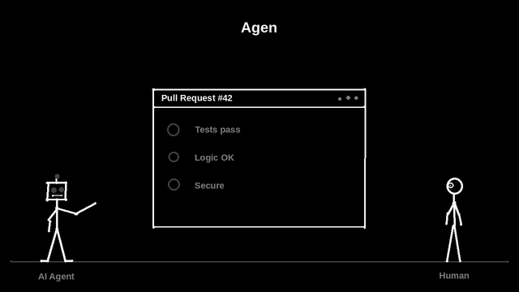
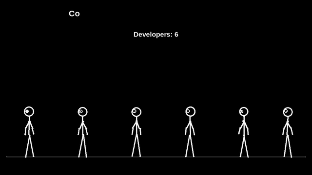
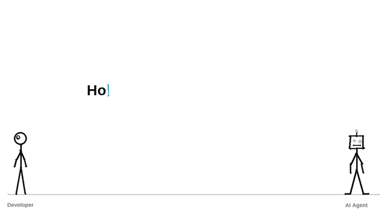

# stickman-anim

Hand-drawn, stop-motion style **stickman animations** for explaining workflows. White line art on black (or black on white), robot stickmen for AI agents, round-head stickmen for people, and a little cyan/green for "working"/"done". Output is a looping GIF or a crisp MP4 up to 4K. It is a small Pillow toolkit, and it also ships as a [Claude skill](#install-as-an-agent-skill).



| | |
|---|---|
|  |  |

## Install

```bash
pip install .            # from a clone; needs Python 3.9+ and Pillow 10.1+
# MP4 output also needs ffmpeg on your PATH (apt install ffmpeg / brew install ffmpeg)
```

## Quick start

```bash
stickman demo pr_review                      # GIF, 1280x720, white on black (the defaults)
stickman demo ci_pipeline video-4k bg-white  # 4K MP4, black on white
stickman render my_scene.py gif-hd           # run your own script with the same flags
```

Your own scene is one function that draws frame `f`:

```python
from stickman_anim import *

N = 40

def render(f):
    c = Frame(f)                                   # jitter is seeded by f -> the hand-drawn "boil"
    c.floor(322)
    c.typed((320, 40), "Hello, agents", font(20), WHITE, clamp((f + 1) / 12), "mm")
    c.robot(120, 322, eye=CYAN, hr=(180, 258))     # an AI agent
    c.human(500, 322)                              # a person
    return c.image()

if __name__ == "__main__":                         # keep the guard: worker processes import this file
    main(render, N, "hello", [5, 20, 39])          # writes hello.gif (or .mp4) + hello_sheet.png
```

Run it: `python hello.py video-hd bg-white`.

## Flags: output format and theme

Plain words after the command (any order), or the `STICKMAN_FLAGS` environment variable.

| Flag | Result |
|---|---|
| `gif` | GIF 640x360 (smallest file) |
| `gif-hd` | GIF 1280x720 (**default**) |
| `video-hd` | MP4 1920x1080, looped 3x |
| `video-4k` | MP4 3840x2160, looped 3x |
| `bg-black` / `fg-white` | white drawing on black (**default**) |
| `bg-white` / `fg-black` | black drawing on white (accents darkened for contrast) |

Naming only one side of the theme implies the other; a clashing pair (`bg-white fg-white`) is an error. Layouts are authored once on a 640x360 canvas and drawn with more pixels at higher quality, so nothing needs re-doing per format.

Typical cost, 56-frame demo / 140-frame scene: GIF 0.7 / 2 MB (`gif`), 1.9 / 4.6 MB (`gif-hd`); MP4 2.2 MB (`video-hd`), about 13 MB (`video-4k`). 4K video takes roughly 2.5 minutes for 140 frames on two cores. GIFs get heavy above HD, so use MP4 for 1080p and 4K.

## What you can draw

`line poly rect circle dashed text typed wipe` primitives; `spinner check cross sparkle packet floor` icons; `robot()` and `human()` characters with arms you can aim; `window() node() avatar()` furniture; `arc_lerp lerp clamp along` motion helpers. Scene recipes (chat to agents, pipelines, kanban, PR graph, diff review...) are in [`skill/stickman-animation/references/patterns.md`](skill/stickman-animation/references/patterns.md), and runnable ones in [`src/stickman_anim/examples`](src/stickman_anim/examples).

Colour has a meaning: grey/dim = idle, cyan = working, green = done, red = failure. `WHITE` means "ink" (near-black in the light theme), so one script works in both themes; never hard-code black or white.

## Fonts and Bangla (non-Latin text)

Text uses Liberation Sans / DejaVu / Arial / Helvetica, whichever it finds (Linux, macOS and Windows locations are searched). Point to a specific font with `STICKMAN_FONT=/path/font.ttf`. For Bengali, use `font(size, bangla=True)` and reveal with `wipe()` rather than slicing characters. This needs a Bengali font and Pillow built with libraqm so conjuncts shape correctly (FreeSans, Noto Sans Bengali, Nirmala UI and Kohinoor Bangla are looked for; `STICKMAN_FONT_BANGLA` overrides). No fonts are bundled, so check each font's licence if you redistribute output made with it.

## Install as an agent skill

`skill/stickman-animation/` is a self-contained skill: `SKILL.md`, a copy of the library (`scripts/stickman_lib.py`), a demo and `references/patterns.md`. The folder name must stay `stickman-animation` and `SKILL.md` must sit at its top level. The skill needs **Python 3.9+** and **Pillow** (`pip install "Pillow>=10.1"`); MP4 output also needs **ffmpeg** on the PATH. The agent runs the bundled scripts itself, so you do not need `pip install .` for the skill (that is only for the `stickman` CLI).

First get the files (from a clone of this repo):

```bash
python tools/sync_skill.py --build     # writes dist/stickman-animation.skill (a zip of the skill folder)
```

### Claude

| Where | How |
|---|---|
| **Claude Code, all projects** | Copy the folder to `~/.claude/skills/stickman-animation/` |
| **Claude Code, one project** | Copy it to `<project>/.claude/skills/stickman-animation/` and commit it so teammates get it |
| **Claude.ai / Claude Desktop** | *Settings → Capabilities → Skills → Upload skill*, then choose `dist/stickman-animation.skill` (or a zip of the folder). Needs code execution enabled. |

```bash
# macOS / Linux
mkdir -p ~/.claude/skills && cp -r skill/stickman-animation ~/.claude/skills/
```
```powershell
# Windows (PowerShell)
New-Item -ItemType Directory -Force "$HOME\.claude\skills" | Out-Null
Copy-Item -Recurse skill\stickman-animation "$HOME\.claude\skills\"
```

Restart Claude Code (or start a new session) and check it is listed. Then just ask, e.g. *"make a stickman animation of an agent opening a PR and a human approving it, 4K video on white"*. The skill triggers on stickman / stop-motion / workflow-explainer requests.

### Other agents (Codex, Cursor, Gemini CLI, Antigravity, ...)

Most coding agents now read the same `SKILL.md` format, so the install is the same copy into that agent's skills folder. Folder names change between versions, so check your agent's docs for the current location; the usual ones are:

| Agent | Typical skills folder |
|---|---|
| Codex CLI | `~/.codex/skills/stickman-animation/` (or `.agents/skills/` in a repo) |
| Gemini CLI / Antigravity | `~/.gemini/skills/stickman-animation/` (or `.gemini/skills/` in a repo) |
| Cursor | `.cursor/skills/stickman-animation/` (if your version has skills), otherwise use the fallback below |

**Fallback for any agent without skills support.** Copy the folder anywhere in your project (e.g. `tools/stickman-animation/`) and add a pointer to the agent's instruction file (`AGENTS.md`, `GEMINI.md`, `.cursor/rules/stickman.mdc`, `CLAUDE.md`):

```markdown
## Stickman animations
To make a stickman / stop-motion explainer GIF or MP4, read `tools/stickman-animation/SKILL.md`
and follow it. Use `tools/stickman-animation/scripts/stickman_lib.py` for drawing.
```

Alternatively, `pip install .` and tell the agent to use the `stickman` CLI and the `from stickman_anim import *` API shown in [Quick start](#quick-start); `skill/stickman-animation/SKILL.md` and `references/patterns.md` are still the best guidance on style and scene recipes.

### Check it works

Ask the agent for a quick scene, or run the bundled demo yourself:

```bash
cd ~/.claude/skills/stickman-animation/scripts   # or wherever you installed it
python example_demo.py gif                       # writes a small GIF + contact sheet
```

If MP4 fails, install ffmpeg (`apt install ffmpeg`, `brew install ffmpeg`, `winget install ffmpeg`). If text is missing glyphs, see [Fonts and Bangla](#fonts-and-bangla-non-latin-text). To update later, `git pull`, run `python tools/sync_skill.py --build`, and copy the folder again (the library has one source, `src/stickman_anim/lib.py`; never edit the skill copy by hand).

## Limitations

- It is a drawing toolkit, not a text-to-animation generator: each scene's layout is hand-placed coordinates (recipes help).
- Rendering is CPU only. Up to 4 processes are used on Linux/macOS-fork platforms; Windows and macOS (spawn) run single-process, so keep your script's render function at module level behind `if __name__ == "__main__"`.
- The visual style is deliberately simple. No brand logos or copyrighted characters are drawn.

## Develop

```bash
pip install -e ".[dev]"
pytest -q                      # MP4 tests skip without ffmpeg
python tools/sync_skill.py     # after editing lib.py or examples/pr_review.py
```

See [CONTRIBUTING.md](CONTRIBUTING.md). MIT licensed, see [LICENSE](LICENSE).
