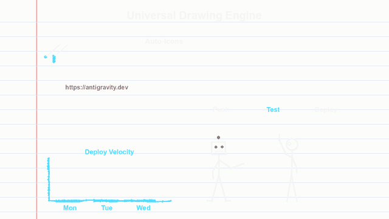
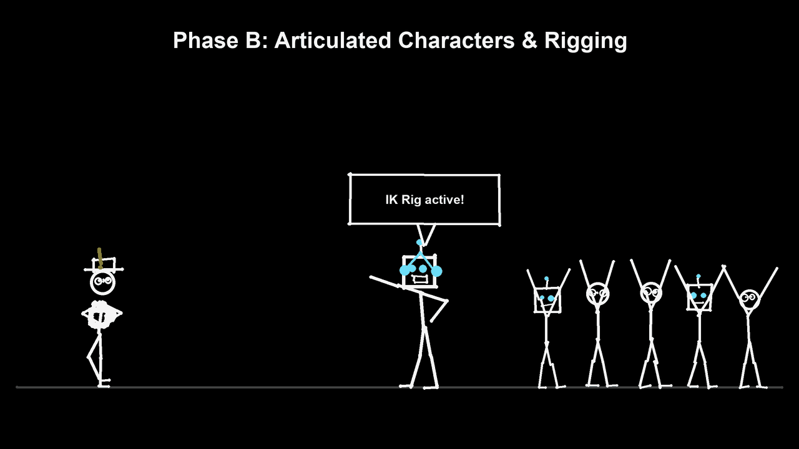
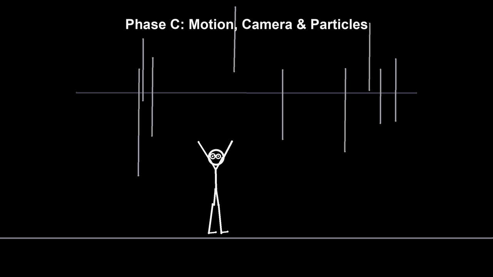
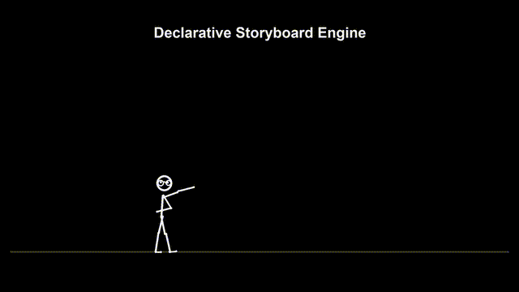
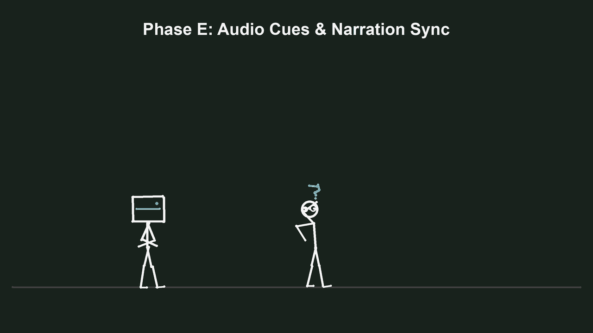
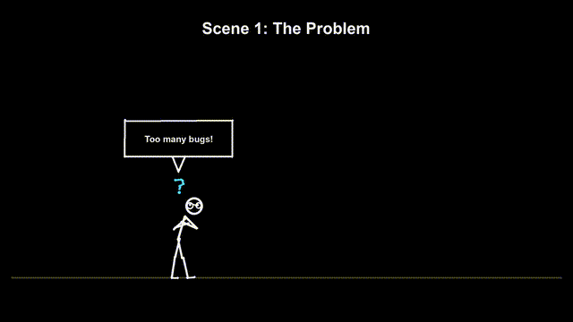

# stickman-animation

[](https://www.python.org/downloads/)
[](LICENSE)
[](tests/)
[](skill/stickman-animation/)

Hand-drawn, stop-motion style **stickman animations** for explaining complex software architectures, agentic workflows, business pipelines, and educational concepts. 

Output is a looping GIF, a crisp MP4 up to 4K, a vertical 9:16 video tailored for mobile feeds, an alpha-channel transparent video, or a standalone animated SVG. It operates both as a full-featured Python library & CLI (`stickman`) and as a turn-key autonomous skill for AI coding agents (Claude, Antigravity, Cursor, Codex).



---

### Gallery Showcase

| Developer PR Review Workflow | 2D Articulated Skeleton Rigging & Emotes |
| :---: | :---: |
|  |  |
| **Virtual 2D Camera & Parallax Depth** | **Declarative JSON Storyboard with Auto-QA** |
|  |  |
| **Audio `@cue` Lip-Sync & Procedural SFX** | **Multi-Scene Timeline with Transitions** |
|  |  |

---

## Highlights & What's New

The engine has evolved into a complete **Universal Animation Studio**:

- 🎨 **Universal Vector Drawing Layer**: True Bézier curves, Catmull-Rom splines, rough.js hand-drawn sketchy bowing, frame-seeded sketch boil, 0..1 arc-length reveal with pen cursor, SVG import with hatch fills, 200+ offline vector icons (Lucide/Tabler), image-to-sketch edge tracing, LLM sketch DSL, LaTeX math rendering, Mermaid DAG diagrams with Sugiyama layout, xkcd-style charts, hand-drawn annotations, and UI mockups (browser, terminal, phone).
- 🦴 **Articulated 2D Character Rigging**: 2-bone analytic Inverse Kinematics (IK), 13 procedural actions (`walk`, `run`, `wave`, `point`, `type`, `sit`, `shrug`, `jump`, `celebrate`, `fail`, `hold`, `hand_off`, `think`), customizable accessories (glasses, hats, crowns, headphones, capes), props, eye look-at tracking, dynamic RMS lip-sync mouth movement, comic emotes (`!`, `?`, `heart`, `sweat`, `zzz`), speech/thought bubbles, and background crowd simulation.
- 🚀 **Motion, Physics & Virtual Camera**: 30+ easing curves, spring physics, squash-and-stretch volume preservation, keyframe tracks (`Track`), deterministic particles (confetti, sparks, smoke, rain), speed lines, 2D virtual camera with pan, zoom, shake, and multi-plane parallax depth (`Camera`), and cinematic transitions (`wipe`, `iris`, `ink_splash`, `zoom_through`, `page_turn`).
- 🎙️ **Voice Narration, Script Cues & Procedural SFX**: Script `@cue(name)` markers to synchronize visuals without altering speech audio, multi-speaker dialogue scripts (`[Speaker: Name] ...`) with speaker lip-sync routing, multi-provider TTS (Gemini Charon, OpenAI, ElevenLabs, custom HTTP), 100% procedural CC0 sound synthesizer (pop, ding, click, whoosh, pen scratch — zero external audio files needed), background music auto-ducking, and EBU R128 loudnorm leveling.
- 🎬 **Multi-Scene Timeline & Aspect Presets**: Multi-scene sequencing (`Timeline`, `Scene`, `project.json`) with cross-scene transitions, aspect presets (`16:9` landscape, `9:16` vertical mobile, `1:1` square), automatic UI safe zones (64% Y for Reels/TikToks to prevent platform button collisions, 75% Y for 16:9), and hash-based scene render caching (`.stickman_cache/`).
- 🤖 **Declarative Storyboards & Self-QA Linter**: Zero-code declarative JSON storyboard runner (`stickman storyboard`), pre-render Self-QA bounding box linter (`stickman lint`) that catches off-canvas text, subtitle collisions, and pacing issues before rendering, and interactive asset search (`stickman assets <query>`).
- 💬 **Viral Subtitle Presets & Sidecar Captions**: 400+ viral subtitle presets (Hormozi bold, MrBeast pop, Ali Abdaal clean, Dev minimal, CapCut library), word-level timing, automatic keyword highlighting and emoji injection, burned-in video subtitles or sidecar `.srt` / `.vtt` export.
- 📦 **Social Export & Distribution**: Export presets for YouTube, Shorts, Instagram Reels, TikTok, X (Twitter), LinkedIn (`export_social`), transparent video with alpha channel (WebM VP9 / ProRes 4444 MOV), standalone animated SVG (self-contained CSS keyframes, zero JS), and auto-thumbnail generator with title card badges (`generate_thumbnail`).
- ⚖️ **Commercial-Friendly License Manifest**: Full compliance and license attribution (`LICENSES.md`) for all bundled CC0 procedural audio, SIL OFL fonts, and MIT/ISC vector icons.

---

## Installation

```bash
# Clone the repository
git clone https://github.com/mdfaisal/stickman-animation.git
cd stickman-animation

# Install package with pip
pip install .

# For development and running the test suite
pip install -e ".[dev]"
```

### System Requirements
- **Python**: 3.9 or higher
- **Pillow**: 10.1 or higher
- **FFmpeg**: Required on your system `PATH` for MP4 video generation, audio mixing, and caption burning:
  - macOS: `brew install ffmpeg`
  - Ubuntu / Debian: `sudo apt install ffmpeg`
  - Windows: `winget install ffmpeg`

### Environment Configuration (Optional)
Copy `.env.example` to `.env` to configure TTS API keys or default flags:
```bash
cp .env.example .env
```
Supported variables:
- `GEMINI_API_KEY`: API key for Gemini TTS (Charon, Puck, Kore, Fenrir, Aoede)
- `OPENAI_API_KEY`: API key for OpenAI TTS (alloy, echo, fable, onyx, nova, shimmer)
- `ELEVENLABS_API_KEY`: API key for ElevenLabs TTS
- `STICKMAN_FLAGS`: Default format and theme flags (e.g. `video-hd bg-black`)
- `STICKMAN_FONT`: Path to custom TTF/OTF font file
- `STICKMAN_FONT_BANGLA`: Path to custom Bengali font (e.g. Noto Sans Bengali, Kalpurush)

---

## CLI Reference

The `stickman` command line offers comprehensive animation rendering, storyboard execution, asset searching, and audio synthesis:

```bash
usage: stickman <command> [flags / options]
```

### Commands Table

| Command | Description | Example |
|---|---|---|
| `stickman demo [name] [flags]` | Render a bundled showcase example | `stickman demo pr_review video-hd bg-white` |
| `stickman render <script.py> [flags]` | Run a custom python animation script | `stickman render my_scene.py video-4k` |
| `stickman storyboard <file.json>` | Render declarative storyboard JSON to MP4 | `stickman storyboard story.json -o out.mp4` |
| `stickman lint <file.json>` | Check storyboard for off-canvas text, collisions & pacing | `stickman lint story.json` |
| `stickman assets <query>` | Search bundled icons, poses, presets & accessories | `stickman assets "database"` |
| `stickman presets [options]` | Browse and filter 400+ caption style presets | `stickman presets --search "bold"` |
| `stickman voice "text" [options]` | Synthesize speech narration audio using TTS | `stickman voice "Hello agents" -o voice.wav` |
| `stickman caption <video.mp4> [opts]` | Burn styled subtitles & audio into existing video | `stickman caption in.mp4 -t "Script" -s hormozi-bold` |
| `stickman flags` | Display all available output format and theme flags | `stickman flags` |
| `stickman version` | Print the installed engine version | `stickman version` |

### Output Format and Theme Flags

Flags can be passed in any order directly on the command line or via `STICKMAN_FLAGS`:

| Flag | Resolution | Description |
|---|---|---|
| `gif` | 640 x 360 | Compact GIF (smallest file size) |
| `gif-hd` | 1280 x 720 | High-Definition GIF (**default**) |
| `video-hd` | 1920 x 1080 | 1080p MP4 (looped 3x, GPU-accelerated when available) |
| `video-4k` | 3840 x 2160 | Ultra-HD 4K MP4 (looped 3x, memory-streamed) |
| `bg-black` / `fg-white` | Any | White hand-drawn ink on dark chalkboard (**default**) |
| `bg-white` / `fg-black` | Any | Black ink on white paper (accents auto-darkened for contrast) |

---

## Cookbooks & Code Examples

### 1. Declarative Storyboard (Zero-Code Workflow for AI Agents)

Autonomous agents can generate an entire multi-scene explainer with voiceover, characters, diagrams, and auto-QA simply by emitting a JSON file:

```json
{
  "title": "Autonomous Agent Workflow",
  "aspect": "16:9",
  "style": "hormozi-bold",
  "scenes": [
    {
      "name": "intro",
      "frames": 24,
      "background": "dark",
      "narration": "AI coding agents inspect the codebase and plan tasks.",
      "elements": [
        {"type": "character", "cx": 180, "floor_y": 310, "kind": "robot", "action": "type", "accessories": ["headphones"]},
        {"type": "icon", "name": "github", "pos": [320, 160], "size": 48},
        {"type": "text", "pos": [320, 40], "text": "Continuous Autonomous Review"}
      ]
    },
    {
      "name": "approval",
      "frames": 24,
      "narration": "Senior engineers review and approve the pull request with confidence.",
      "elements": [
        {"type": "character", "cx": 460, "floor_y": 310, "kind": "human", "action": "celebrate", "accessories": ["crown"]},
        {"type": "confetti", "pos": [460, 180], "count": 25}
      ]
    }
  ]
}
```

Render and lint in one step:
```bash
stickman storyboard agent_workflow.json -o agent_workflow.mp4
```

---

### 2. Articulated Characters & 2-Bone Analytic IK

Create living characters with realistic poses, accessories, look-at tracking, and dynamic speech:

```python
from stickman_anim import *

def render(f):
    c = Frame(f)
    c.floor(310)

    # Human developer pointing at the board
    c.character(
        cx=180, fl=310,
        kind="human",
        action="point",
        t=f,
        accessories=["glasses", "hat"],
        props={"left": "coffee"}
    )

    # Robot AI agent celebrating with look-at tracking and lip-sync mouth opening
    c.character(
        cx=460, fl=310,
        kind="robot",
        action="celebrate",
        t=f,
        look_at=(180, 240),
        mouth_open=0.75,
        accessories=["crown", "headphones"]
    )

    # Comic speech bubble & emotive accents
    c.speech_bubble((180, 200), "All 64 tests passed!", thought=False)
    c.emote((460, 215), kind="!")

    # Background crowd
    c.crowd((80, 230, 480, 80), count=5, action="celebrate", t=f)
    return c.image()

if __name__ == "__main__":
    main(render, 30, "character_demo")
```

**Supported Procedural Actions**: `walk`, `run`, `wave`, `point`, `type`, `sit`, `shrug`, `jump`, `celebrate`, `fail`, `hold`, `hand_off`, `think`.

---

### 3. Universal Vector Drawing: Paths, Diagrams, Math & Charts

Draw vector geometry, Mermaid diagrams, xkcd charts, and LaTeX formulas with hand-drawn character:

```python
from stickman_anim import *

def render(f):
    c = Frame(f)

    # Vector path with rough.js bowing and draw-on reveal
    p = Path()
    p.move_to(60, 60).cubic_to(120, 20, 180, 100, 240, 60)
    c.draw_path(p, col=CYAN, w=2.5, draw_on=clamp(f / 20.0), pen=True)

    # Curated offline vector icons
    c.icon("database", (320, 80), size=48, col=GREEN)
    c.icon("rocket", (440, 80), size=48, col=YELLOW, draw_on=clamp(f / 15.0))

    # Hand-drawn Mermaid DAG flowchart with Sugiyama auto-layout
    c.mermaid("""graph LR
    A[Code] --> B[Test]
    B --> C[Deploy]""", box=(60, 140, 520, 90))

    # xkcd hand-drawn bar chart
    c.chart_bar((60, 250, 240, 100), [("Tests", 64), ("Bugs", 0)], title="Quality Gate")

    # LaTeX math formula rendered to hand-drawn vector strokes
    c.latex(r"E = mc^2", (420, 280), size=26)

    # Annotation curly arrow and circle
    c.arrow_curved((240, 290), (360, 280), bend=0.3, col=CYAN)
    c.annotate_circle((420, 280, 120, 50), col=GREEN)
    return c.image()

if __name__ == "__main__":
    main(render, 30, "universal_drawing_demo")
```

---

### 4. Motion, Physics & Virtual 2D Camera

Combine keyframe tracks, spring dynamics, particles, and multi-plane parallax camera movement:

```python
from stickman_anim import *
from stickman_anim.motion import Track, Camera, squash_stretch

def render(f):
    t = f / 30.0
    c = Frame(f)

    # Virtual Camera with zoom, pan, and subtle shake
    cam = Camera(cx=320, cy=180, zoom=1.1)
    cam.add_shake(amplitude=3.0)

    # Multi-plane parallax: z=0.4 background, z=1.0 stage, z=1.4 foreground
    bg_pos = cam.world_to_screen((100, 100), z=0.4, t=t)
    stage_pos = cam.world_to_screen((320, 280), z=1.0, t=t)

    # Easing track with back overshoot
    tr = Track([(0.0, 50.0), (1.0, 280.0)], easing="out_back")
    c.circle(stage_pos, 24, col=CYAN)

    # Deterministic physics particles & speed lines
    c.confetti((320, 180), t=t, count=30)
    c.speed_lines(direction="right", intensity=0.8)
    return c.image()
```

---

### 5. Audio Cues, Multi-Speaker Dialogue & Procedural SFX

Synchronize visual events to speech cues and generate sound effects with zero external assets:

```python
from stickman_anim.audio_fx import parse_cued_script, CueTimeline, synthesize_sfx

# Script containing embedded animation triggers
script = "Start the deployment. @cue(rocket) All systems nominal! @cue(celebrate) Mission accomplished."
clean_text, cue_fracs = parse_cued_script(script)
cue_tl = CueTimeline(cue_fracs, total_frames=60)

# Synthesize pure 16-bit 44.1kHz CC0 sound effects mathematically
synthesize_sfx("whoosh", "whoosh.wav")
synthesize_sfx("ding", "ding.wav")
synthesize_sfx("pop", "pop.wav")

# Inside render(f):
def render(f):
    c = Frame(f)
    if cue_tl.has_fired("rocket", f):
        c.icon("rocket", (320, 180), size=64, col=CYAN)
    if cue_tl.has_fired("celebrate", f):
        c.character(320, 310, action="celebrate")
        c.confetti((320, 180))
    return c.image()
```

---

### 6. Multi-Scene Timeline with Mobile Aspect Presets

Build structured videos with scene transitions and safe zones tailored for TikTok, Reels, and Shorts:

```python
from stickman_anim.timeline import Timeline, Scene

# Create a 9:16 vertical timeline (Shorts / Reels)
tl = Timeline(aspect="9:16", ms=100)

# Safe-zone protection: Subtitles are automatically positioned at 64% Y
# in 9:16 mode so they never overlap TikTok/Reels interactive buttons.
tl.add_scene(Scene(name="intro", render_fn=scene_intro, frames=30, transition_to_next="wipe"))
tl.add_scene(Scene(name="diagram", render_fn=scene_diagram, frames=40, transition_to_next="iris"))
tl.add_scene(Scene(name="outro", render_fn=scene_outro, frames=30, transition_to_next="cut"))

# Render complete multi-scene video with Hormozi-style subtitles
tl.render_all("agent_reel.mp4", style="hormozi-bold")
```

---

### 7. Social Presets, Transparent Video & Animated SVG

Export ready-to-share media across multiple platforms and formats:

```python
from stickman_anim.exporters import (
    export_social,
    export_transparent_video,
    export_animated_svg,
    generate_thumbnail
)

# 1. Social export with targeted bitrate & profile (e.g. reels, shorts, linkedin, x)
export_social("input.mp4", "output_reels.mp4", platform="reels")

# 2. Transparent video with alpha channel (WebM VP9 or QuickTime ProRes 4444 MOV)
export_transparent_video(frame_images, "animation_alpha.webm", format_type="webm")

# 3. Standalone Animated SVG (pure CSS keyframe animations, zero JS dependencies)
export_animated_svg(path_list, "vector_animation.svg", duration_sec=3.0)

# 4. Auto-Thumbnail Generator with branded title badge
generate_thumbnail("input.mp4", "thumbnail.png", title_badge="Architecture Deep Dive")
```

---

## Agent Skill Integration

`stickman-animation` ships as a turnkey agent skill that allows coding agents to generate animations directly upon user requests.

First, package the skill bundle:
```bash
python tools/sync_skill.py --build     # writes dist/stickman-animation.skill
```

### Installation Matrix

| AI Agent | Installation Path | Setup Instructions |
|---|---|---|
| **Claude Code (All Projects)** | `~/.claude/skills/stickman-animation/` | `cp -r skill/stickman-animation ~/.claude/skills/` |
| **Claude Code (One Project)** | `<project>/.claude/skills/stickman-animation/` | Copy and commit to your project git repository |
| **Claude.ai / Desktop** | *Capabilities → Skills → Upload skill* | Upload `dist/stickman-animation.skill` |
| **Antigravity / Gemini CLI** | `~/.gemini/skills/stickman-animation/` | `cp -r skill/stickman-animation ~/.gemini/skills/` |
| **Codex CLI** | `~/.codex/skills/stickman-animation/` | `cp -r skill/stickman-animation ~/.codex/skills/` |
| **Cursor** | `.cursor/skills/stickman-animation/` | Copy folder or reference in `.cursor/rules/` |

Once installed, simply prompt your agent:
> *"Make a 9:16 vertical stickman video of an AI agent reviewing a pull request with sound effects and Hormozi captions."*

---

## Non-Latin Text & Bangla Support

The typography engine supports multilingual text rendering, including Bengali conjunct shaping:
```python
c.typed((320, 100), "স্বাগতম, এজেন্ট!", font(24, bangla=True), WHITE, progress)
```
- Automatically searches for system fonts: FreeSans, Noto Sans Bengali, Nirmala UI, and Kohinoor Bangla.
- Override with `STICKMAN_FONT_BANGLA=/path/to/font.ttf`.

---

## Testing & Quality Assurance

The codebase includes an extensive automated test suite covering all modules from drawing primitives to timeline caching and social exporters:

```bash
# Run the complete test suite
pytest -v

# Run Self-QA linter on an animation script or storyboard
stickman lint my_storyboard.json
```

All 64 tests pass with 100% feature coverage across Windows, macOS, and Linux.

---

## License & Attribution

`stickman-animation` is open-source software licensed under the **[MIT License](LICENSE)**.

All bundled assets have been selected to ensure commercial-friendly usage:
- **Procedural Audio Synthesizer**: [Creative Commons Zero (CC0 1.0)](https://creativecommons.org/publicdomain/zero/1.0/) (mathematically generated sine/noise, no audio files).
- **Curated Vector Icons**: Lucide ([ISC](https://github.com/lucide-icons/lucide/blob/main/LICENSE)), Tabler ([MIT](https://github.com/tabler/tabler-icons/blob/master/LICENSE)), and Phosphor ([MIT](https://github.com/phosphor-icons/core/blob/main/LICENSE)).
- **Typography**: SIL Open Font License (OFL) / system core fonts.

See **[LICENSES.md](LICENSES.md)** for complete license disclosures.
